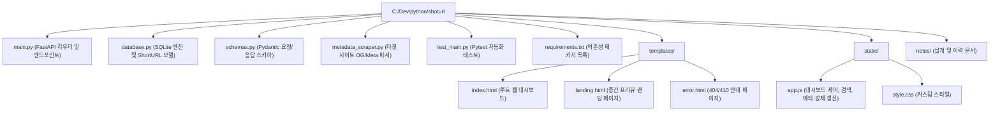

# ShortURL 서비스 개발 명세서 (SPECIFICATION)

- **작성일시**: 2026-10-17 13:54
- **프로젝트명**: ShortURL (메타 프리뷰 중간 랜딩 및 링크 관리 대시보드 서비스)
- **기반 프레임워크**: FastAPI + SQLite + Jinja2 / Modern Responsive UI

---

## 1. 개요 및 서비스 목적

본 서비스는 긴 원본 URL(Long URL)을 입력받아 `https://domain/{shorturl}` 형태의 짧은 단축 링크로 변환하고 제공하는 웹 애플리케이션입니다.

- **기본 루트 패스 (`/`)**: 단축 링크 생성, 검색, 통계 확인, 메타정보 강제 갱신(Refresh), 삭제 등을 수행하는 **Web UI 대시보드**를 제공합니다.
- **하위 패스 (`/{shorturl}`)**: 단축 코드로 접속 시 타겟 사이트로 즉시 이동하기 전에 **타겟 사이트의 메타정보(제목, 설명 미리보기, 대표 이미지, 파비콘 등)**와 Open Graph(OG) 태그를 포함한 **중간 랜딩 페이지(Preview Landing Page)**를 제공하여 사용자에게 대상 사이트 정보를 안내하고 안전하게 이동시킵니다.
- **유효기간 정책**: SQLite 데이터베이스로 링크 매핑을 관리하며, 생성 시점으로부터 **기본 1년(365일)이 경과하면 링크가 자동 만료/소멸**되도록 설계합니다.

---

## 2. 상세 구현 요구사항 및 기능 정의

### 2.1 라우팅 및 접근 구조
1. **`GET /` (루트 패스 - Web UI 대시보드)**
   - 긴 URL 입력 및 단축 링크 즉시 생성
   - 이미 생성된 단축 링크 검색(코드, 원본 URL, 메타 제목/설명 기준) 및 필터링
   - 각 링크별 메타정보 미리보기 카드/행 표시 및 **메타정보 강제 갱신(Refresh) 버튼** 제공
   - QR 코드 생성, 클립보드 복사, 만료일 확인(기본 1년), 링크 삭제 기능 제공
2. **`GET /{short_code}` (하위 패스 - 메타정보 중간 랜딩 페이지)**
   - 단축 링크 접속 시 클릭 수를 증가시키고, 저장된 타겟 사이트의 메타정보(제목, 요약 설명, OG 이미지, 대상 URL)를 보여주는 **중간 랜딩 페이지(`landing.html`)** 렌더링
   - 카카오톡, 슬랙, 디스코드 등 외부 메신저에 단축 링크 공유 시에도 미리보기가 표시되도록 중간 랜딩 페이지의 `<head>`에 `<meta property="og:...">` 태그 동적 주입
   - 랜딩 페이지에서 **"지금 바로 이동하기" 버튼** 및 선택적 자동 이동 카운트다운(취소 가능) 제공
   - 만료된 링크(생성 후 1년 경과 등) 접근 시 `410 Gone` 안내 및 소멸 처리

### 2.2 타겟 사이트 메타정보 수집 및 강제 갱신 (Metadata Scraper)
1. **수집 항목**
   - `meta_title`: `<meta property="og:title">` → `<meta name="twitter:title">` → `<title>` 순으로 추출
   - `meta_description`: `<meta property="og:description">` → `<meta name="description">` 순으로 추출
   - `meta_image`: `<meta property="og:image">` → `<meta name="twitter:image">` 순으로 추출 (상대 경로일 경우 `urllib.parse.urljoin`으로 절대 경로 변환)
   - `favicon_url`: `<link rel="icon">` 또는 기본 `/favicon.ico` 절대 경로
   - `meta_updated_at`: 메타정보 마지막 수집/갱신 시각
2. **강제 갱신 (Force Refresh)**
   - UI 대시보드 및 중간 랜딩 페이지에서 **[메타정보 새로고침(갱신)]** 버튼 클릭 시 `POST /api/urls/{short_code}/refresh-meta` 호출
   - 타겟 URL에 재접속하여 최신 HTML 메타데이터를 파싱하고 SQLite DB를 즉시 업데이트한 뒤 최신 결과를 반환

### 2.3 링크 유효기간 및 1년 후 소멸 정책
1. **기본 1년(365일) 유효기간 부여**
   - 링크 생성 시 사용자가 별도 만료일을 지정하지 않으면 `created_at + 365일(1년)`을 `expires_at` 기본값으로 자동 설정
2. **만료 검증 및 소멸(Purge) 지원**
   - 만료 시각이 지난 링크는 대시보드에서 `만료됨` 상태로 표시되며, 접속 시 `410 Gone` 에러 페이지 응답
   - 만료된 링크를 일괄 정리/삭제할 수 있는 API(`DELETE /api/urls/expired/purge`) 및 대시보드 정리 기능 제공

---

## 3. 패키지 및 디렉토리 구성도

---

## 4. 기능 세부 내역 설명

| 구분 | 기능명 | 엔드포인트 / 모듈 | 세부 동작 설명 |
| :--- | :--- | :--- | :--- |
| **UI** | 웹 대시보드 | `GET /` | Long URL 입력, 커스텀 코드 설정, 생성된 링크 검색/조회, 메타정보 미리보기 및 강제 갱신 버튼 제공 |
| **UI** | 중간 랜딩 페이지 | `GET /{short_code}` | 타겟 사이트의 제목, 설명, 대표 이미지(OG Image), 원본 URL을 표시하고 이동 버튼 및 카운트다운 제공 |
| **API** | 단축 링크 생성 | `POST /api/urls` | URL 유효성 검증, 타겟 사이트 메타정보 최초 추출, 만료일 미지정 시 생성 후 1년(`+365 days`) 자동 설정 |
| **API** | 링크 목록/검색 조회 | `GET /api/urls?q=` | 검색어(`q`)로 단축코드, 원본 URL, 메타 제목/설명을 필터링하여 최신순 반환 |
| **API** | 단축 링크 단건 조회 | `GET /api/urls/{short_code}` | 특정 단축 링크의 메타데이터, 클릭 수, 만료 여부 상세 조회 |
| **API** | **메타정보 강제 갱신** | `POST /api/urls/{short_code}/refresh-meta` | 타겟 URL을 다시 요청하여 최신 OG/Meta 태그(제목, 설명, 이미지)를 재수집 및 DB 갱신 |
| **API** | 만료 링크 일괄 소멸 | `DELETE /api/urls/expired/purge` | 생성 후 1년이 경과했거나 만료일이 지난 링크를 DB에서 일괄 삭제 |
| **API** | 단축 링크 삭제 | `DELETE /api/urls/{short_code}` | 선택한 단축 링크를 즉시 삭제 |

---

## 5. 개발 검토 시 필요한 제약사항 (Constraints)

1. **타겟 사이트 크롤링 차단 및 타임아웃**
   - 일부 웹사이트는 봇 접근을 차단하거나 응답이 지연될 수 있습니다.
   - **대응**: `httpx` 요청 시 표준 브라우저 `User-Agent` 헤더를 설정하고, 타임아웃(예: 4.0초) 및 최대 응답 크기 제한을 두어 대상 사이트 장애가 단축 URL 생성을 실패시키지 않도록 안전한 Fallback(호스트명 기반 기본 타이틀)을 적용합니다.
2. **SSRF(Server-Side Request Forgery) 및 비정상 스킴 방지**
   - 메타정보 수집기가 내부망(`localhost`, `127.0.0.1`, 사설 IP 대역)이나 `http/https` 외의 스킴을 호출하지 않도록 URL 스킴 검증 및 안전한 예외 처리를 수행합니다.
3. **시스템 예약어 충돌 방지**
   - `/api`, `/docs`, `/static`, `/redoc`, `/openapi.json`, `/favicon.ico` 등 내부 시스템 경로가 단축 코드(`/{short_code}`)로 생성되지 않도록 예약어 필터링을 강제합니다.
4. **상대 경로 이미지 처리**
   - 타겟 사이트의 `og:image`가 `/images/logo.png`와 같이 상대 경로로 작성된 경우 `urljoin(original_url, og_image)`를 통해 전체 URL로 변환해야 랜딩 페이지와 대시보드에서 정상 렌더링됩니다.
5. **SQLite 동시성 및 타임존 일관성**
   - 모든 생성 시각(`created_at`)과 만료 시각(`expires_at`, 기본 +365일), 메타 갱신 시각(`meta_updated_at`)은 UTC 기준으로 비교하여 타임존 오차를 방지합니다.

---

## 6. 추가 개발 제안 내용 (Future Enhancements)

1. **자동/수동 이동 옵션 제어**: 링크 생성 시 또는 쿼리 파라미터(`?direct=1`)를 통해 중간 랜딩 페이지를 거칠지 즉시 307 리다이렉트할지 선택하는 옵션 제공
2. **클릭 상세 분석(Analytics)**: 시간대별 클릭 추이, 접속 국가/디바이스(User-Agent), 리퍼러(Referer) 통계 차트 추가
3. **백그라운드 스케줄러 자동 정리**: 매 자정마다 1년 경과 만료 링크를 자동 물리 삭제(Hard Delete)하거나 아카이빙하는 배치 작업 연동
4. **악성 URL 필터링 (Safe Browsing)**: Google Safe Browsing API 등과 연동하여 피싱/악성 사이트 단축 생성 차단 및 중간 랜딩 페이지 내 보안 경고 배지 표시
